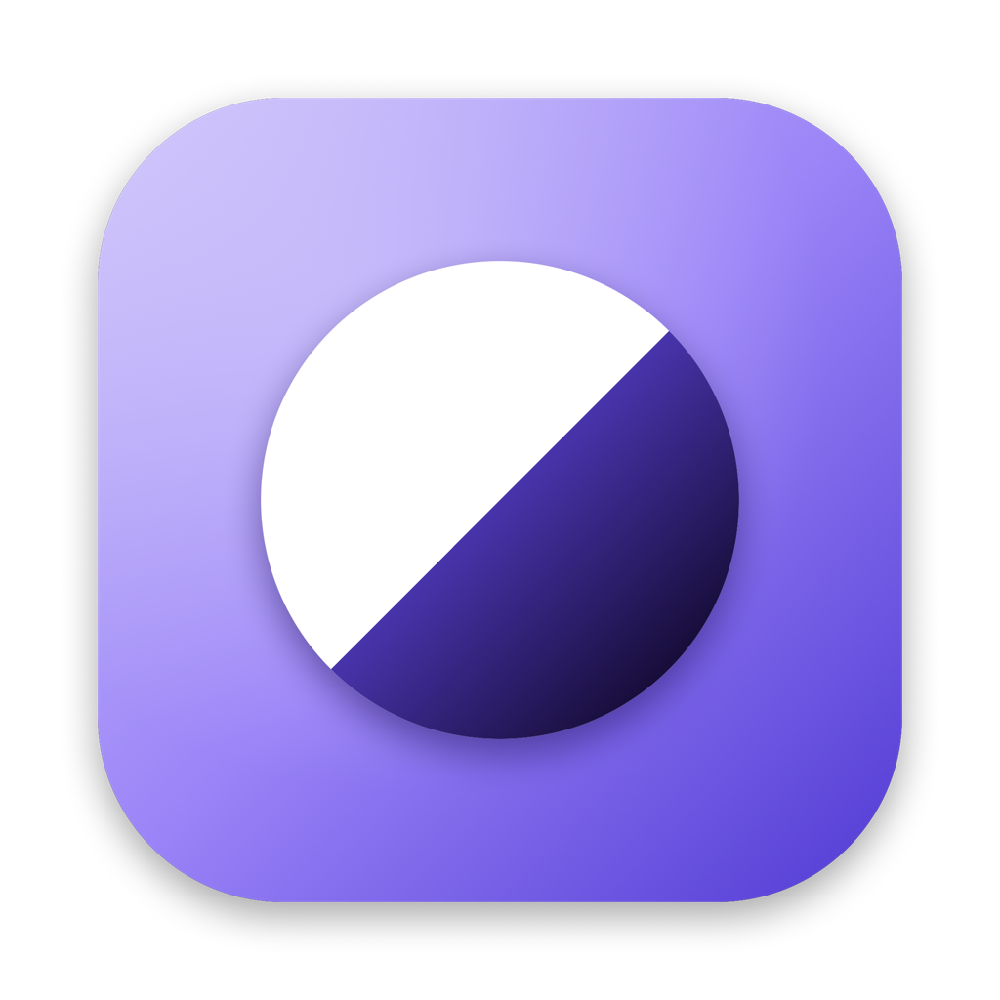
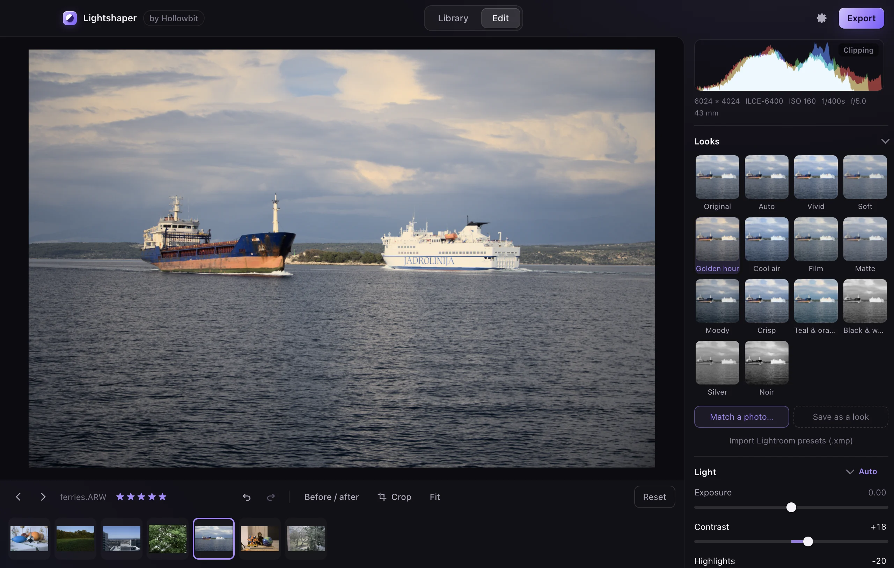

<p align="center">
  <a href="https://hollowbit.dev/lightshaper/"></a>
</p>

<h1 align="center">Lightshaper</h1>

<p align="center"><b>A free, offline photo editor.</b></p>
<p align="center">Sliders, masks, looks, camera RAW and batch export. Your originals are never changed.</p>

<p align="center">
  <a href="https://github.com/hollowbit-dev/lightshaper/releases/latest"></a>
  
  
  <a href="LICENSE"></a>
</p>

<p align="center">
  <a href="https://hollowbit.dev/lightshaper/"></a>
</p>

<p align="center"></p>

## What it does

- Open single photos or whole folders: JPEG, PNG, WebP, AVIF, HEIC/HEIF, TIFF (8 and 16-bit), JPEG XL, PSD, BMP, GIF and camera RAW (CR2, CR3, NEF, ARW, RAF, DNG, ORF, RW2, PEF, GPR and more, via LibRaw).
- Export to JPEG, PNG, WebP or TIFF (8 or 16-bit).
- Light, colour and effects sliders, tone curve, colour mixer, colour grading, noise reduction, crop and straighten.
- Gradient and radial masks, white balance picker, clipping warning, star ratings.
- 14 hand-made looks, your own looks, and **Match a photo**: copy another photo's tones and colours into ordinary sliders.
- Opens Lightroom presets (.xmp and .lrtemplate). Not affiliated with Adobe.
- Copy and paste edits, or apply a look to many photos at once. Export them all as JPEG, PNG or WebP.
- Your originals are never changed. No account, no tracking, no AI.

> Windows builds have not been tried on a real PC yet. If something breaks, please [open an issue](https://github.com/hollowbit-dev/lightshaper/issues/new).

## Install

Get the installer from the [website](https://hollowbit.dev/lightshaper/) or the [latest release](https://github.com/hollowbit-dev/lightshaper/releases/latest).

- **Mac:** open the .dmg and drag Lightshaper to Applications. The first time, right-click it and choose **Open**, because the app isn't signed yet.
- **Windows:** run the installer. If SmartScreen appears, click **More info**, then **Run anyway**.

With Homebrew:

```sh
brew tap hollowbit-dev/tap
brew trust hollowbit-dev/tap
brew install --cask lightshaper
```

## Develop

```
npm install
npm start          # run
npm test           # engine renders + UI walkthrough (needs sample photos in samples/)
npm run dist       # installers in dist/
```

## More free apps from Hollowbit

- **[Melodyshaper](https://hollowbit.dev/melodyshaper/)**: hum a tune, make a song
- **[Clipshaper](https://hollowbit.dev/clipshaper/)**: long videos to short clips
- **[Captionshaper](https://hollowbit.dev/captionshaper/)**: offline auto subtitles
- **[Fileshaper](https://hollowbit.dev/fileshaper/)**: compress, convert, sign PDFs
- **[Writeshaper](https://hollowbit.dev/writeshaper/)**: offline writing assistant
- **[Moveshaper](https://hollowbit.dev/moveshaper/)**: move to a new computer
- **[Diskshaper](https://hollowbit.dev/diskshaper/)**: clean up storage
- **[Startshaper](https://hollowbit.dev/startshaper/)**: find out why your PC is slow
- **[Fuseduo](https://fuseduo.com/)**: automate your Mac apps

## Licence

MIT. Decoders: [LibRaw](https://www.libraw.org/) (LGPL/CDDL) through libraw-wasm, [libheif](https://github.com/strukturag/libheif) (LGPL) through libheif-js, libjxl through [jSquash](https://github.com/jamsinclair/jSquash) (Apache-2.0), [UTIF.js](https://github.com/photopea/UTIF.js) (MIT) and [ag-psd](https://github.com/Agamnentzar/ag-psd) (MIT). `npm run vendor` rebuilds their bundles in src/renderer/vendor.

---

<p align="center"><sub>Made by <a href="https://hollowbit.dev">Hollowbit Studio</a>. If Lightshaper helped you, a ⭐ helps other people find it.</sub></p>
